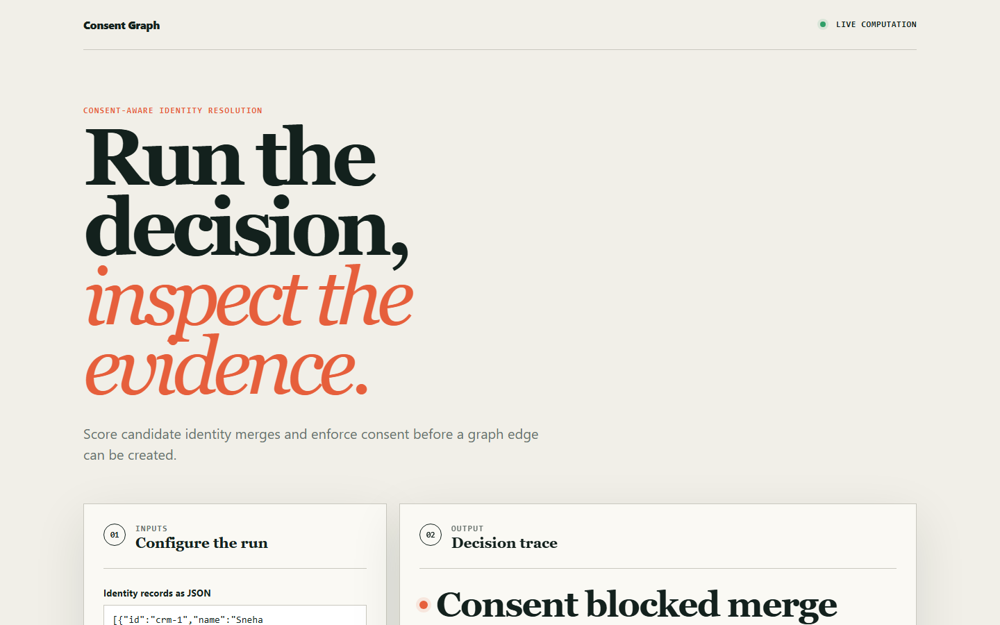
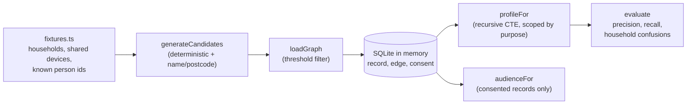

# consentgraph

Identity resolution where consent and purpose gate the join itself, measured on precision because a false merge is the expensive error.

[](https://github.com/csalekhya/consentgraph/actions/workflows/ci.yml)
[Live demo](https://csalekhya.github.io/consentgraph/)



## Why

A retailer wants one view of a customer across web, app, in-store card and email. Probabilistic matching will happily merge two people in the same household onto one profile, so someone gets marketing based on a relative's browsing, or sees their purchase history. Separately, consent granted for email does not justify an ad-platform audience match, yet the same resolved profile feeds both.

The usual fix is to resolve everything and filter at send time, but by then the inference has been made. consentgraph makes consent and purpose properties of the graph edge, so a link that is not allowed for a purpose is never traversed for it.

## Features

- Deterministic links (email, loyalty ID, hashed phone) plus probabilistic links (name and postcode, shared device) with a tunable threshold.
- Purpose-scoped traversal: the same graph returns different profiles for `email_marketing`, `ad_platform_match` and `service`.
- Consent ledger with per-purpose state, jurisdiction and full history; withdrawal takes effect in the same transaction.
- Precision, recall and a separate household-confusion count, evaluated against planted ground truth.
- A synthetic generator that produces households with shared devices, name noise and known person IDs.
- A browser demo of the consent-gated merge decision, deployed to GitHub Pages.

## Architecture



Candidate links are generated from shared identifiers and from name similarity within a postcode block, then loaded as edges above a score threshold. Each edge kind lists the purposes it may serve. `profileFor` walks only the edges allowed for the requested purpose using a recursive CTE. See [docs/ARCHITECTURE.md](docs/ARCHITECTURE.md).

## Quick start

Prerequisites: Node.js 22.18 or newer (24 recommended). TypeScript runs through Node's built-in type stripping and the database is `node:sqlite`, so there is no install step and no build.

```bash
git clone https://github.com/csalekhya/consentgraph.git
cd consentgraph
npm test        # precision, consent and site tests
npm run demo    # prints the comparison below
```

## Example

`npm run demo` resolves 300 synthetic households and reports quality per purpose (trimmed):

```text
  1,432 source records, 472 real people, 365 household pairs.

  purpose             precision   recall    links    household confusions
  email_marketing     1.0000      0.860     1401     0
  ad_platform_match   1.0000      0.888     1447     0
  service             0.8458      1.000     1926     297  <- BELOW FLOOR

  ONE RECORD (id 30, Pria Okafor, PC0006)
    email_marketing     2 records, 1 real person
    ad_platform_match   2 records, 1 real person
    service             3 records, 1 real person
```

Marketing purposes hold the precision floor with zero household confusions. The service purpose is allowed to use household evidence, so it resolves more and is less precise. That trade is reported, not averaged away.

## How it works

| Evidence | email_marketing | ad_platform_match | service |
| --- | --- | --- | --- |
| Email, loyalty ID | yes | yes | yes |
| Hashed phone | no | yes | yes |
| Name and postcode, shared device | no | no | yes |

- **Edges carry purpose.** `EDGE_PURPOSES` in `src/graph.ts` maps each evidence type to the purposes it may be used for. Household-level evidence is never available to marketing.
- **Consent is a ledger.** Rows are appended with person, purpose, granted flag, jurisdiction and timestamp. The latest row wins and `hasConsent` returns false when none exists. A withdrawal is an insert, so the next read in the same transaction sees it.
- **Precision first.** `evaluate` checks every pair of records placed in one profile against the true person ID, and counts household confusions (false pairs sharing a postcode) separately.
- **Ground truth is evaluation-only.** `true_person` is stored for scoring and is never read by the resolver.

## Testing

```bash
npm test
```

`tests/precision.test.ts` asserts precision at or above 0.99 and zero household confusions for marketing purposes, that recall stays useful, that the fixture really contains households, that purposes give different profiles for the same record, and that withdrawn consent applies immediately while history is retained. `site/core.test.mjs` covers the browser demo logic. CI also runs `scripts/validate_site.py` and deploys `site/` to Pages.

## Project layout

```text
src/graph.ts         schema, candidate generation, consent, purpose-scoped traversal
src/evaluate.ts      precision, recall, household confusion
src/fixtures.ts      seeded synthetic generator with ground truth
src/demo.ts          the demo printed above
tests/               precision and consent tests
site/                browser demo (GitHub Pages)
docs/                architecture notes and screenshots
```

## Limitations

- In-memory SQLite and synthetic data; there is no persistent store or API.
- Name matching is a simple similarity score, not a trained probabilistic model.
- Jurisdiction is recorded on consent rows but does not change traversal.
- Not a customer data platform: it covers resolution and consent only.

## License

MIT, see [LICENSE](LICENSE).

## Maintainer

Currently maintained by **Sai Alekhya Chandramouli**, Business Intelligence Analyst & Developer, with 4+ years of experience building analytics and reporting solutions. This project was originally created by **csalekhya**.

[LinkedIn](https://www.linkedin.com/in/alekhya-chandramouli/) · [Email](mailto:alekhya.chandramouli@gmail.com)