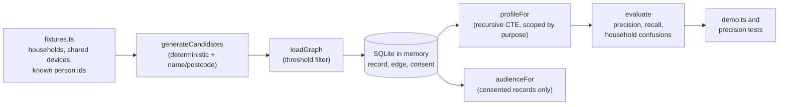

# Architecture

## Context

A retailer holds customer records in several systems: web sessions, the app,
in-store loyalty cards and email. Joining them gives one customer view, but a
join made with the wrong evidence is harmful. Two people in the same household
share an address and often a device, so probabilistic matching merges them. And
consent given for email does not cover an ad-platform audience match, even though
both use the same resolved profile.

consentgraph resolves identities in a way that makes those two mistakes
structurally hard: consent and purpose decide which links may be traversed, and
quality is measured as precision against known ground truth.

## Container view

Everything runs in one process against an in-memory SQLite database
(`node:sqlite`), so there is nothing to install or provision.

## Key decisions

### Purpose-scoped edges

Every edge kind lists the purposes it may be used for (`EDGE_PURPOSES` in
`src/graph.ts`). Email and loyalty matches are usable everywhere, phone matches
only for ad matching and service, and the household-level evidence (shared
device, name plus postcode) only for service. `profileFor` builds the set of
allowed edge kinds from the purpose and walks only those edges with a recursive
CTE. The same graph therefore yields a different profile per purpose.

The alternative, resolving everything and filtering at send time, makes the
inference before the check. Scoping at traversal means the unlawful link is never
followed.

Trade-off: marketing purposes give up some recall (0.860 for email marketing in
the demo) in exchange for a precision of 1.0 and no household confusions.

### Precision as the primary metric

A missed link gives a slightly worse audience. A false merge can show someone
another person's purchase history. `evaluate` counts pairs of records placed in
the same profile and checks them against the planted `true_person` id. Household
confusions (a false pair in the same postcode) are counted separately from other
false positives. The tests assert a floor of 0.99 precision for marketing
purposes.

### Consent as an append-only ledger

Consent rows carry person, purpose, granted flag, jurisdiction and timestamp.
The current state is the row with the latest timestamp, and earlier rows are
kept as history. A withdrawal is an insert, so it is visible to the next read in
the same transaction; there is no batch job in between.

## Failure modes

- A threshold set too low on the service purpose creates household confusions.
  The demo shows this (precision 0.8458 for service) and the tests assert it, so
  the trade is visible rather than averaged away.
- No consent row means no consent: `hasConsent` returns false.
- Ground-truth ids live in the `record` table for evaluation only and are never
  read by the resolver.

## Out of scope

- A persistent store, an HTTP API or any connection to a real CDP.
- Probabilistic scoring beyond the name similarity used here. Production systems
  would use a model such as Fellegi-Sunter; the candidate generator is the
  extension point.
- Jurisdiction rules: the jurisdiction is recorded on each consent row but does
  not change traversal.
